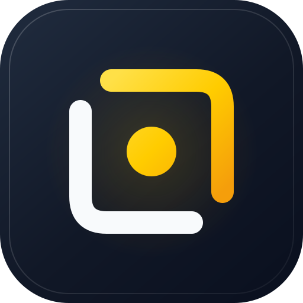
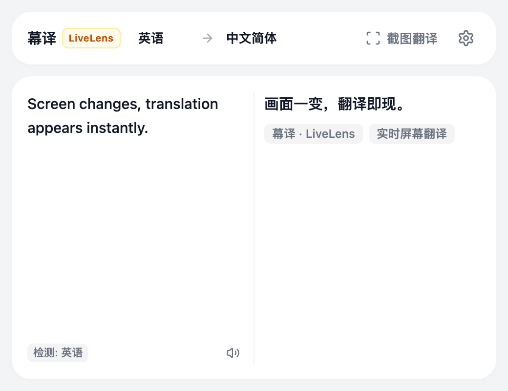

<p align="center">
  
</p>

<h1 align="center">LiveLens (幕译)</h1>

<p align="center">
  <strong>Screen changes, translation appears instantly.</strong><br/>
  A lightweight, native desktop screen translator with smart region selection, real-time live overlay & mirror translation, local OCR, and multi-engine / local LLM translation.
</p>

<p align="center">
  <strong>English</strong> · <a href="README.zh-CN.md">简体中文</a>
</p>

---

## Preview



## Why LiveLens?

LiveLens is built with **Tauri 2 + React 19 + Rust** for instant startup, low memory footprint, and native macOS / Windows / Linux performance. Whether you are reading foreign-language docs, watching videos or live streams, playing games, or inspecting UI text, LiveLens lets you translate any part of your screen on demand—or continuously in real time.

## Key Features

### 1. Smart Region Selection & Floating Toolbar
- **Auto-detects windows & menu bars** on hover, or drag freely to select any region.
- **8-direction resize handles & drag-to-move** for pixel-accurate framing before running an action.
- Unified floating action bar right below the selection:
  - **Region Translate (`选区翻译`)**: Static OCR + in-place visual translation overlay with one-click Original / Translated comparison and copy.
  - **OCR Text (`识别文字`)**: Extracts text into an editable popup dialog with character count and one-click copy.
  - **In-Place Live (`原位实时`)**: Click-through transparent overlay directly above the selected screen region.
  - **Mirror Live (`副屏实时`)**: Independent resizable window syncing live screen frames via macOS `ScreenCaptureKit` with synchronized translated overlays.

### 2. Dual-Mode Real-Time Screen Translation
- **In-Place Live Overlay**: Always-on-top, transparent, and mouse click-through so you can keep scrolling, clicking, or playing underneath. Supports switching between **in-place text blocks** and a **bottom subtitle bar**, plus **bilingual** display.
- **Live Mirror Window**: Mirrors the selected region into a standalone resizable window with real-time translated overlays. Supports **Smart Keyframe** mode (low CPU/battery for reading & scrolling) and **Smooth Stream** mode (continuous video), plus pause/resume, hide/show overlay, and one-click copy.

### 3. Flexible OCR & Translation Engines
- **OCR Engines**:
  - **Apple Vision** (macOS native, offline, fast & accurate)
  - **RapidOCR** (standalone local HTTP OCR service, cross-platform)
  - **Youdao Image Translate** (one-click switchable cloud image translation pipeline)
- **Translation Engines**:
  - **Local / OpenAI-compatible LLMs**: Built-in presets for **HY-MT1.5-1.8B** (`Ollama`, `llama.cpp`, `MLX`) and any OpenAI-compatible API endpoint with customizable system prompts.
  - **Built-in Web Engines**: Bing, Google, Microsoft, Tencent TransMart, Yandex, and iCiba.

### 4. Clean Desktop Experience
- **Quick Text Translation Workspace**: Type or paste text with automatic language detection, text-to-speech playback, and one-click copy.
- **In-Place Preferences**: Compact settings view inside the main window without awkward vertical resizing.
- **System Tray Resident**: Closing the main window minimizes to the tray (monochrome template icon on macOS) with global shortcuts and optional launch-at-login.
- **Flexible Networking**: Supports system proxy, custom HTTP/SOCKS proxy, or direct connection.

> For local LLM & standalone RapidOCR setup instructions, see [docs/LOCAL_MODELS.md](docs/LOCAL_MODELS.md).  
> For architecture and phased milestones, see [docs/ROADMAP.md](docs/ROADMAP.md).

## Shortcuts & Interactions

| Action | Description |
|--------|-------------|
| `Ctrl+Shift+X` | Global shortcut to start **Region Translate** (customizable in Settings) |
| `Ctrl+Shift+C` | Global shortcut to start **OCR Text** recognition (customizable in Settings) |
| **Hover + Click** | Snap selection to an application window |
| **Left-Drag** | Draw a custom capture region |
| **Right-Click inside result** | Toggle between translated overlay and original screen |
| `Esc` / **Right-Click outside** | Cancel capture or close preview |
| **Click Tray Icon** | Show main window |
| **Right-Click Tray Icon** | Open tray menu (Show Window / Quit) |

## Installation & macOS Notes

Download the latest prebuilt package for your platform from [GitHub Releases](https://github.com/Arbor4/LiveLens/releases).

### macOS First Launch (Unsigned Build)
If macOS Gatekeeper blocks a self-built or unsigned `.app` bundle on first launch, remove the quarantine attribute:

```bash
sudo xattr -cr /Applications/LiveLens.app
```

### macOS Screen Recording Permission
1. On first capture, grant **Screen & System Audio Recording** permission to **LiveLens** in **System Settings → Privacy & Security → Screen & System Audio Recording**.
2. If you upgraded or replaced the app and macOS still reports missing permission even though the switch is enabled, open **Settings → Screen Recording Permission** inside LiveLens and click **Reset Permission (`重置权限`)**—LiveLens will automatically clear the stale TCC record, relaunch, and open System Settings for you.

## Tech Stack

- **Frontend**: React 19, TypeScript, Tailwind CSS v4, Lucide Icons, Vite
- **Desktop Runtime**: Tauri 2 (Rust backend + multi-window WebView)
- **Screen Capture & Live Streaming**:
  - **macOS**: CoreGraphics, `ScreenCaptureKit` (live frame streaming), Apple Vision (native OCR)
  - **Windows / Linux**: `screenshots` + `winit` + `softbuffer` native selection overlay

## Project Structure

```text
.
├── index.html                  # Main window entry
├── capture.html                # Region selection window entry
├── overlay.html                # Click-through in-place live overlay entry
├── live-controls.html          # Floating live control bar entry
├── mirror.html                 # Live mirror window entry
├── src/                        # React + TypeScript frontend
│   ├── App.tsx                 # Main window root
│   ├── components/             # HeaderBar, TranslationWorkspace, SettingsPanel, CaptureView, MirrorView, OverlayView, LiveControlsView
│   ├── constants/              # Languages, engines, LLM presets, proxy configs
│   ├── lib/                    # Tauri IPC wrappers, shortcut & focus utilities
│   ├── styles/                 # Tailwind CSS global styles
│   └── types/                  # TypeScript types
├── src-tauri/                  # Tauri 2 Rust backend
│   ├── tauri.conf.json         # Tauri app & bundle configuration
│   ├── native/                 # macOS Objective-C bridges (Apple Vision OCR & ScreenCaptureKit)
│   └── src/
│       ├── lib.rs              # App bootstrap, tray icon & plugin setup
│       ├── live.rs             # Live capture loop, change detection & local frame server
│       ├── capture/            # Screen capture & native selection window
│       ├── commands/           # Tauri IPC commands (capture, live, overlay, settings, translate, window)
│       └── translators/        # OCR pipelines & multi-engine / LLM translators
└── docs/                       # Local model guide & roadmap
```

## Local Development & Build

### Prerequisites
- **Node.js** 20+ and `npm`
- **Rust** stable toolchain
- **Tauri CLI v2**: `cargo install tauri-cli --version "^2"`

### Run in Development

```bash
npm install
cargo tauri dev
```

### Build for Production

```bash
cargo tauri build
```

Release bundles are generated in `src-tauri/target/release/bundle/`.

### Run Tests

```bash
npm test
cargo test --manifest-path src-tauri/Cargo.toml
```

## License

MIT
