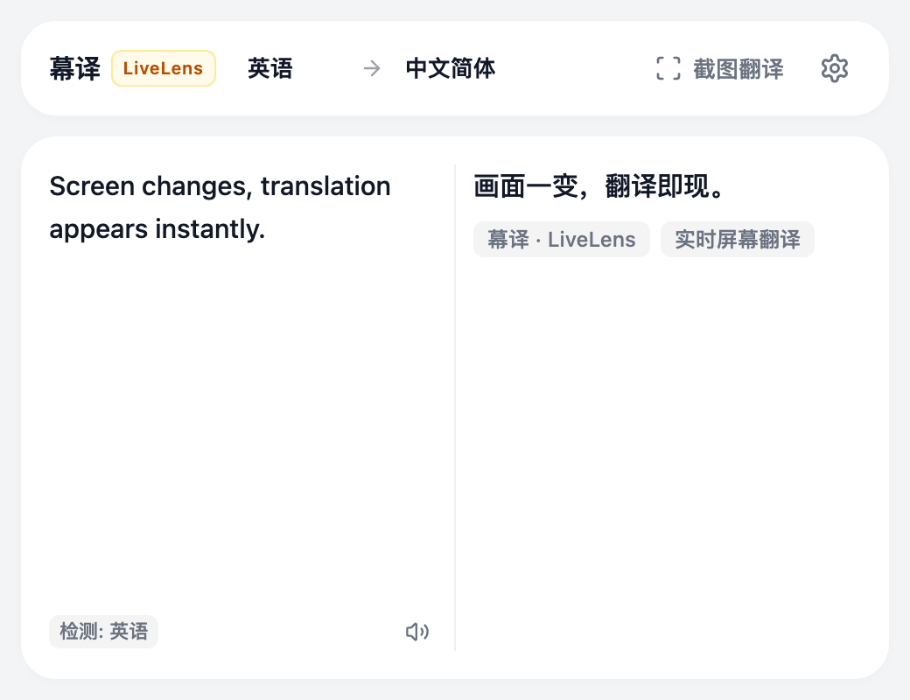

<p align="center">
  
</p>

<h1 align="center">幕译 · LiveLens</h1>

<p align="center">
  <strong>画面一变，翻译即现。</strong><br/>
  轻量级桌面屏幕选区翻译、实时覆译与多引擎文本翻译工具。
</p>

<p align="center">
  <a href="README.md">English</a> · <strong>简体中文</strong>
</p>

---

## 演示



## 简介

幕译（LiveLens）基于 **Tauri 2 + React 19 + Tailwind CSS + Rust** 构建，兼具秒开启动、原生性能与极简交互。  
“幕”指屏幕与画面，“Live”强调实时响应，“Lens”寓意镜头所及、看见即译。无论是阅读外文文档、看视频直播、还是体验外语软件与游戏，都能随框随译或实时同步翻译。

## 核心特性

- **智能选区与悬浮工具栏**：悬停自动吸附软件窗口与顶部菜单栏，支持 8 向拖拽微调与整体移动；选定后通过悬浮工具栏一键执行「选区翻译 / 识别文字 / 原位实时 / 副屏实时」。
- **识别文字弹窗**：OCR 识别结果弹出可编辑文本框展示（含字数统计），支持自由选取或一键复制。
- **双模式实时屏幕翻译**：
  - **原位实时模式**：透明置顶且鼠标穿透，直接在原区域上方覆盖实时译文，支持区块原位覆盖 / 吸底字幕条切换与双语对照。
  - **副屏实时模式**：独立可缩放/全屏窗口，通过 macOS `ScreenCaptureKit` 同步选区画面并叠加实时译文，支持智能关键帧省电模式与流畅录屏模式。
- **可配置 OCR 与本地大模型**：
  - OCR 支持 macOS 原生 **Apple Vision**、外置独立 **RapidOCR** 服务，以及随时切回 **有道图片翻译**。
  - 文本翻译支持 **HY-MT1.5-1.8B**（Ollama / llama.cpp / MLX）等 OpenAI 兼容本地/云端大模型，以及必应、Google、微软、腾讯、Yandex、词霸。
- **主窗口快捷文本翻译**：支持自动语种检测、语音朗读、一键复制译文，设置页在主窗口内原位切换不拉伸界面。
- **网络代理与托盘常驻**：支持系统代理、自定义代理与直连模式；关闭主窗口自动隐藏至系统托盘（macOS 无背景自适应模板图标），支持全局快捷键唤醒与开机静默自启。

> 本地模型与独立 RapidOCR 服务安装指南见 [docs/LOCAL_MODELS.md](docs/LOCAL_MODELS.md)，分阶段演进文档见 [docs/ROADMAP.md](docs/ROADMAP.md)。

## 快捷键与交互

| 操作 | 说明 |
|------|------|
| `Ctrl+Shift+X` | 全局快捷键，启动「选区翻译」（可在设置中修改） |
| `Ctrl+Shift+C` | 全局快捷键，启动「识别文字」（可在设置中修改） |
| **鼠标悬停 + 单击** | 自动吸附选中当前软件窗口 |
| **鼠标左键拖拽** | 自由框选需要翻译或识别的屏幕区域 |
| **区域内鼠标右键** | 在译文与原文画面之间快速切换 |
| `Esc` / **区域外右键** | 取消选区或关闭预览 |
| **点击托盘图标** | 唤醒主窗口 |
| **右键托盘图标** | 打开托盘菜单（显示窗口 / 退出） |

## macOS 运行与权限说明

如果本地自行打包或下载的未签名版本首次打开被系统拦截，可执行：

```bash
sudo xattr -cr /Applications/LiveLens.app
```

- 首次使用选区或实时翻译时，请在 **系统设置 → 隐私与安全性 → 录屏与系统声音** 中勾选 **LiveLens**。
- 如果覆盖安装新版本后开关已开仍提示无权限，可在软件内 **设置 → 录屏权限** 点击「重置权限」，应用会自动清理旧 TCC 记录、重启并打开系统设置供重新勾选。

## 本地开发与构建

### 环境要求
- Node.js 20+ 与 `npm`
- Rust 工具链（stable）
- Tauri CLI v2（`cargo install tauri-cli --version "^2"`）

### 安装依赖与运行

```bash
npm install
cargo tauri dev
```

### 生产打包与测试

```bash
cargo tauri build
npm test
cargo test --manifest-path src-tauri/Cargo.toml
```

打包产物位于 `src-tauri/target/release/bundle/` 目录下。
